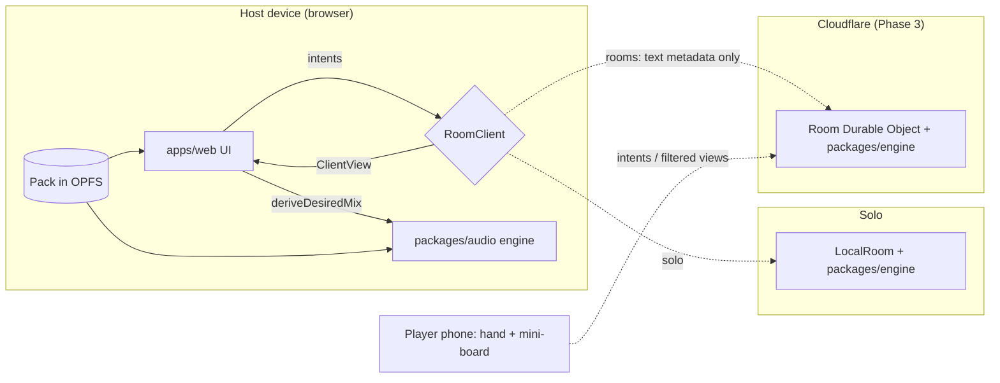
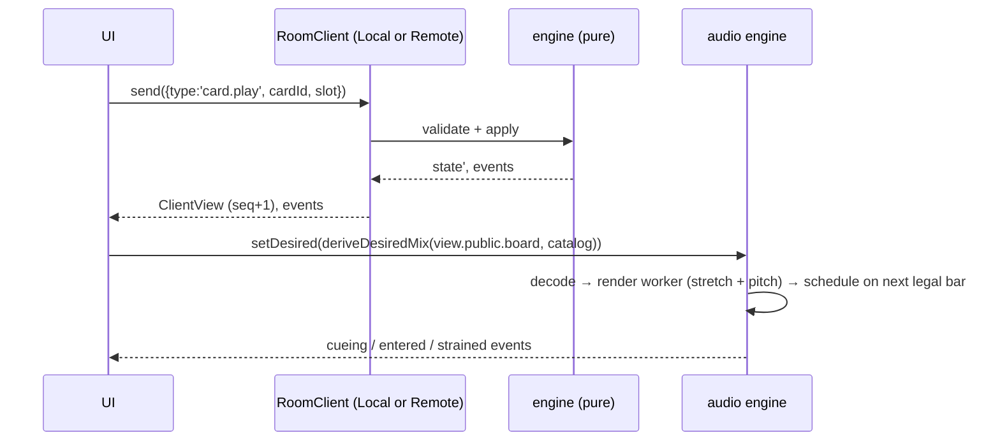

# Architecture

Living document. Scope and rules: `docs/BUILD_PROMPT.md`. Decisions: `docs/decisions/`.

## Runtime topology

Only the host plays audio. Audio and art never leave the host device.

## Data flow for one card play

## Packages

| Package | Depends on | Purpose |
|---|---|---|
| `@stemdeck/harmony` | — | key/tempo/grid math, tunable music constants |
| `@stemdeck/engine` | harmony | rules, modes, `LocalRoom`, deterministic RNG |
| `@stemdeck/pack` | engine, harmony, zod, fflate | pack schema, JSON Schema export, zip → OPFS, `Catalog` |
| `@stemdeck/protocol` | engine, zod | room message schemas, `RemoteRoom` |
| `@stemdeck/audio` | harmony, engine, pack | transport, render pool, reconciler, graph |
| `@stemdeck/ui` | engine, pack | shared React components |
| `@stemdeck/web` | all of the above | the PWA |
| `@stemdeck/rooms` | engine, protocol | Worker + Room Durable Object |

## Tunable constants

Every number the game can be tuned by, and where it lives in code. Change the code and this table together.

### Music (`packages/harmony/src/contracts.ts`)

| Constant | Value | Notes |
|---|---|---|
| `TEMPO_RANGE` | 90–157 BPM | master tempo range |
| `REMIX_BPM_RANGE` | 95–140 BPM | Remix button, uniform |
| `TRANSPOSE_RANGE` | −6…+5 semitones | drums never shift |
| `LEAD_SOFT_SHIFT_LIMIT` | 4 semitones | beyond → `strained` |
| `STRETCH_LIMITS.soft.lead` | 0.85–1.18 | ratio r = master / (native · fold) |
| `STRETCH_LIMITS.soft.{loop,beat,bass}` | 0.80–1.25 | |
| `STRETCH_LIMITS.hard` | 0.66–1.5 | beyond → next fold |
| `PHRASE_BARS` | 4 | big changes land on phrase boundaries |
| `CYCLE_BARS` | 16 | global cycle; loops phase-lock to it |
| `DEFAULT_ENTRY_EVERY` | beat 1, bass 1, loop 2, lead 4 bars | entry quantization |

### Board and rules (`packages/engine/src/contracts.ts`)

| Constant | Value |
|---|---|
| `DEFAULT_BOARD_CONFIG.slots` | S1 bass/beat · S2 beat · S3 beat/loop · S4 loop · S5 loop/lead |
| `DEFAULT_BOARD_CONFIG.stackLimit` | 10 |

Mode-specific numbers (Clash, Party, Puzzle, FX) are added here in Phase 4.

### Audio (`packages/audio/src/contracts.ts`)

| Constant | Value | Notes |
|---|---|---|
| `LEVEL_GAIN_DB` | L1 −5 dB · L2 −2.5 dB · L3 0 dB | mix prominence |
| `schedulerTickMs` | 25 ms | worker timer |
| `scheduleAheadSec` | 0.15 s | minimum lookahead |
| `entryMarginSec` | 0.1 s | added to render ETA |
| `cueingBars` | 2 | emit `cueing` beyond this |
| `fadeSec` | 0.010 s | every start/stop/swap |
| `stopAfterSec` | 0.03 s | old source stop after fade start |
| `seamCrossfadeSec` | 0.010 s | from handle audio |
| `nonBassHighpassHz` | 120 Hz | |
| `leadDucksLoopDb` | −2 dB | |
| `cacheBytesDesktop` / `cacheBytesMobile` | 256 MB / 128 MB | render LRU |
| `maxRenderWorkers` | 3 | pool = min(3, cores − 1) |

### Rooms (`packages/protocol/src/contracts.ts`)

| Constant | Value |
|---|---|
| `PROTOCOL_VERSION` | 1 |
| room code | 4 letters from `ABCDEFGHJKMNPQRSTUVWXYZ` |
| `rateLimitPerSecond` | 20 |
| `maxMessageBytes` | 64 KiB |
| `maxPlayers` | 8 (host + 7) |
| `idleExpiryMs` | 30 min |
| `catalogChunk` / `catalogMaxCards` | 200 / 4000 |

### Budgets (§16.2)

| Metric | Budget |
|---|---|
| Render 8-bar stereo loop (stretch + pitch) | ≤400 ms laptop, ≤1200 ms phone |
| Audio dropouts, 5 slots + FX, 10 min | 0 on the user's phone |
| Player intent → host board update (p95) | ≤250 ms |
| Player controller route JS | ≤300 KB gzipped |
| Host decoded/rendered audio memory | ≤256 MB desktop, ≤128 MB mobile |
| Import 100-song pack on laptop | ≤60 s |
| Forge per song on GPU | ≤90 s |
